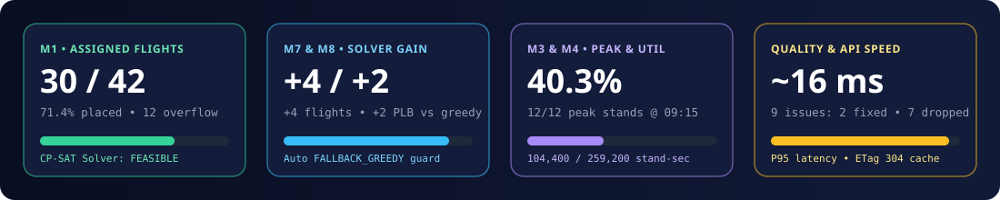
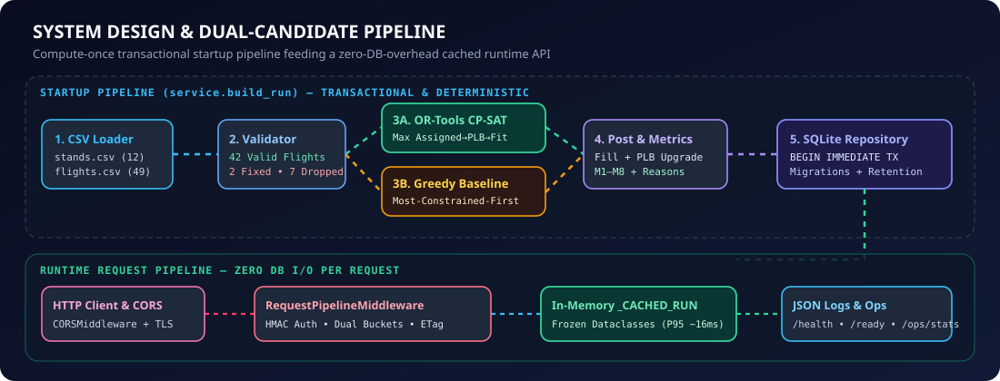
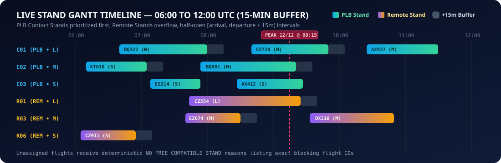

<div align="center">

<!-- Animated SVG Hero Banner -->


<br/><br/>

<!-- Dynamic Typing Subtitle -->
<a href="https://github.com/kanglesoham11-code/airport-stand-allocation">
  
</a>

<br/>

<!-- Colorful Tech & Status Badges -->
<p>
  
  
  
  
  
  
  
  
</p>

<p>
  <a href="#-key-features"><b>Features</b></a> •
  <a href="#%EF%B8%8F-system-design--architecture"><b>System Design</b></a> •
  <a href="#-optimization-model--timeline"><b>Optimization</b></a> •
  <a href="#-tech-stack"><b>Tech Stack</b></a> •
  <a href="#-api-endpoints"><b>API Reference</b></a> •
  <a href="#-quick-start"><b>Quick Start</b></a>
</p>

</div>

---

## ✈️ About The Project

**Aleph Airport Stand Allocation** is a production-hardened aviation operations engine that assigns arriving and departing aircraft (`S`, `M`, `L`) to airport stands (`PLB` Passenger Loading Bridge contact gates and `REMOTE` apron stands) over a 6-hour planning window (`06:00–12:00 UTC`), enforcing safety turnaround buffers, stand-size compatibility, deterministic data cleaning, and explainable operational metrics.

Built from [`Aleph_Stand_Allocation_Build_Spec_v4.docx`](./Aleph_Stand_Allocation_Build_Spec_v4.docx), the service computes the entire optimization run **once at startup**, persists full provenance in SQLite inside a single atomic transaction, and serves requests from an **immutable in-memory cache** at sub-20ms P95 latency.

<div align="center">
  
</div>

---

## 🌟 Key Features

<table>
  <tr>
    <td width="50%" valign="top">
      <h3>🧠 Dual-Candidate Optimization</h3>
      <ul>
        <li><b>Primary Exact Solver:</b> Google OR-Tools <b>CP-SAT</b> with interval variables, <code>AddNoOverlap</code> per stand, and lexicographic objective weights:
          <br/><code>Maximize(Assigned Flights → PLB Stands → Best Size Fit)</code></li>
        <li><b>Greedy Baseline:</b> Most-constrained-first heuristic for transparent benchmarking.</li>
        <li><b>Automatic Guardrail:</b> Shared post-processing (fill + PLB upgrade + re-fill) and automatic <code>FALLBACK_GREEDY</code> if greedy ever matches or beats the solver.</li>
      </ul>
    </td>
    <td width="50%" valign="top">
      <h3>🧹 16-Step Data Validation Engine</h3>
      <ul>
        <li>Deterministic row-by-row inspection of <code>flights.csv</code> with full audit trail.</li>
        <li><b>Auto-Repair (<code>FIXED</code>):</b> Normalizes lowercase sizes (<code>"m" → "M"</code>) and converts timezone-offset timestamps (<code>+05:30 → UTC</code>).</li>
        <li><b>Safe Rejection (<code>DROPPED</code>):</b> Catches bad field counts, empty/duplicate IDs, unknown sizes, naive/fractional timestamps, reversed pairs, out-of-window arrivals, and invalid ground times (<code>&lt;20m</code> or <code>&gt;8h</code>).</li>
      </ul>
    </td>
  </tr>
  <tr>
    <td width="50%" valign="top">
      <h3>🛡️ Production Security &amp; Resilience</h3>
      <ul>
        <li><b>Constant-Time API Key Auth:</b> <code>hmac.compare_digest</code> across all configured keys (min 32 chars, placeholder/duplicate keys rejected at startup).</li>
        <li><b>Dual Token-Bucket Rate Limiting:</b> Independent LRU-bounded buckets for general traffic (60 cap, 1/s refill) and brute-force auth failures (5 cap, 1/12s refill) with <code>Retry-After</code> headers.</li>
        <li><b>HTTP Hardening:</b> <code>CORSMiddleware</code>, <code>X-Frame-Options: DENY</code>, <code>nosniff</code>, <code>Content-Length</code> guards (400/413), and strict query validation.</li>
      </ul>
    </td>
    <td width="50%" valign="top">
      <h3>📊 Explainability &amp; Observability</h3>
      <ul>
        <li><b>Actionable Unassigned Reasons:</b> Every unplaced flight reports <code>NO_FREE_COMPATIBLE_STAND</code> or <code>NO_STAND_FOR_SIZE</code> with exact blocking flight IDs.</li>
        <li><b>8 Planning KPIs (<code>M1–M8</code>):</b> Assigned/unassigned counts, sweep-line peak demand, clipped stand utilisation (<code>Decimal ROUND_HALF_UP</code>), tight turns (<code>&lt;30m</code>), oversized placements, and gains over baseline.</li>
        <li><b>Run-Aware Caching &amp; Telemetry:</b> SHA-256 <code>ETag</code> / <code>304 Not Modified</code>, JSON-line access logs (key fingerprints only), and <code>/ops/stats</code> P95 latency.</li>
      </ul>
    </td>
  </tr>
</table>

---

## 🏗️ System Design & Architecture

<div align="center">
  
</div>

### Request & Data Flow (Mermaid)

```mermaid
flowchart LR
    classDef input fill:#0f2347,stroke:#38bdf8,color:#e0f2fe,stroke-width:2px
    classDef process fill:#1e1b4b,stroke:#818cf8,color:#e0e7ff,stroke-width:2px
    classDef solver fill:#064e3b,stroke:#34d399,color:#d1fae5,stroke-width:2px
    classDef store fill:#31102f,stroke:#f472b6,color:#fce7f3,stroke-width:2px
    classDef api fill:#172554,stroke:#60a5fa,color:#dbeafe,stroke-width:2px

    A["📄 CSV Inputs<br/>stands.csv & flights.csv"]:::input --> B["🔍 loader.py<br/>BOM-safe, size & row limits"]:::process
    B --> C["🧹 validation.py<br/>16-step FIXED/DROPPED audit"]:::process
    C --> D["⚡ solver_cpsat.py<br/>OR-Tools CP-SAT Exact"]:::solver
    C --> E["📐 allocator.py<br/>Most-Constrained Greedy"]:::solver
    D --> F["🔄 post_process()<br/>Fill → PLB Upgrade → Fill"]:::process
    E --> F
    F --> G["📊 metrics.py<br/>M1–M8 + Blocker Reasons"]:::process
    G --> H["💾 repository.py<br/>SQLite Atomic TX + Retention"]:::store
    H --> I["🧠 _CACHED_RUN<br/>Frozen In-Memory State"]:::solver
    I --> J["🚀 FastAPI + Middleware<br/>Auth • Rate Limit • CORS • ETag"]:::api
```



### Architectural Highlights

| Layer | Design Choice | Why It Matters |
|---|---|---|
| **Domain Models** (`models.py`) | `@dataclass(frozen=True)` | Immutable domain state (`Flight`, `Stand`, `Allocation`, `SavedRun`) safely shared across concurrent reads without locks. |
| **Zero-DB Read Path** (`api.py`) | Startup-built `_CACHED_RUN` | Run is computed and saved once at startup; API endpoints serve directly from memory with zero per-request SQLite I/O. |
| **Database Safety** (`db.py`, `repository.py`) | `BEGIN IMMEDIATE`, `PRAGMA foreign_keys=ON`, schema versioning | Single-transaction saves (`INCOMPLETE` → `COMPLETE`), automatic cleanup of old runs (`RUN_RETENTION=10`), and future-schema guard. |
| **Fair Benchmarking** (`allocator.py`) | Shared `post_process()` | Both CP-SAT and greedy candidates run the exact same fill and PLB-upgrade passes before comparison. |
| **Security & Middleware** (`middleware.py`, `ratelimit.py`, `security.py`) | Per-IP dual buckets + constant-time key check | Prevents timing attacks and brute-force key guessing while preserving `/health` and `/ready` availability for orchestrators. |

---

## 📅 Optimization Model & Timeline

<div align="center">
  
</div>

### Mathematical Formulation (`solver_cpsat.py`)

- **Decision Variables:** Boolean $x_{f,s} \in \{0, 1\}$ for every compatible pair where `SIZE_RANK[stand.max_size] >= SIZE_RANK[flight.aircraft_size]`, paired with optional interval variables over $[t_{\text{arr}}(f),\; t_{\text{dep}}(f) + \text{buffer})$.
- **Constraint C1 (Assignment):** $\sum_{s \in \text{compat}(f)} x_{f,s} \le 1$ — each flight gets at most one stand.
- **Constraint C2 (No Overlap + Buffer):** `AddNoOverlap` across all intervals assigned to stand $s$, enforcing the 15-minute turnaround buffer (`[arrival, departure + 15m)` half-open).
- **Lexicographic Objective:** Integer-scaled weights guarantee strict priority order:
  1. **Maximize total assigned flights**
  2. **Maximize PLB (contact bridge) assignments**
  3. **Minimize size waste** (`SIZE_RANK[stand.max_size] - SIZE_RANK[flight.aircraft_size]`)

---

## 🛠️ Tech Stack

<div align="center">

| Category | Technologies | Role in Project |
|---|---|---|
| **Web Framework** |    | Async ASGI HTTP API, OpenAPI `/docs`, `CORSMiddleware`, `BaseHTTPMiddleware` |
| **Optimization** |  | Exact CP-SAT interval scheduling & lexicographic optimization |
| **Validation & Types** |   | Strict `Literal`-constrained response schemas, `Decimal` precision, frozen dataclasses |
| **Persistence** |  | Versioned schema migrations, transactional run storage, retention pruning |
| **Quality & Testing** |     | 44 unit & integration tests (incl. brute-force solver verification), linting, static typing |
| **Containerization** |  | Multi-layer `python:3.10-slim` container with built-in `/health` probe |

</div>

---

## 📡 API Endpoints

> All data endpoints require the `X-API-Key` header. Every response includes `X-Request-ID`, security headers, and rate-limit headers (`X-RateLimit-*`). Cacheable GET routes emit run-scoped `ETag` headers supporting `If-None-Match` → `304 Not Modified`.

| Method & Path | Auth | Description |
|---|---|---|
| `GET /health` | No | Liveness probe (`{"status": "ok"}`) |
| `GET /ready` | No | Readiness probe with active `run_id`, stand/flight/issue counts, and `solver_status` |
| `GET /docs` | No | Interactive Swagger UI backed by `Literal`-typed OpenAPI schemas |
| `GET /allocations` | **Yes** | Paginated flight allocations (`?status=ASSIGNED\|UNASSIGNED&limit=100&offset=0`) |
| `GET /stands` | **Yes** | List of all 12 airport stands (`PLB` / `REMOTE`, `S` / `M` / `L`) |
| `GET /stands/{stand_id}` | **Yes** | Stand details and assigned flights timeline (e.g., `/stands/C01`) |
| `GET /data-issues` | **Yes** | Paginated validation audit log (`FIXED` and `DROPPED` rows) |
| `GET /metrics` | **Yes** | Full `M1–M8` operational & baseline-comparison KPIs |
| `GET /ops/stats` | **Yes** | Uptime, `2xx/3xx/4xx/5xx` counts, rate-limit/auth-failure counters, P95 latency |

<details>
<summary><b>📦 Sample API Responses (Click to expand)</b></summary>

**`GET /ready`**
```json
{
  "status": "ready",
  "run_id": "run-0002",
  "stands": 12,
  "valid_flights": 42,
  "data_issues": 9,
  "loaded_at": "2026-11-25T12:34:29.541Z",
  "allocator": "cpsat",
  "primary_method": "cpsat",
  "solver_status": "FEASIBLE"
}
```

**`GET /allocations?status=UNASSIGNED&limit=1`**
```json
{
  "planning_window": { "start": "2027-01-15T06:00:00Z", "end": "2027-01-15T12:00:00Z" },
  "run_id": "run-0002",
  "allocator": "cpsat",
  "primary_method": "cpsat",
  "solver_status": "FEASIBLE",
  "total": 12,
  "limit": 1,
  "offset": 0,
  "allocations": [
    {
      "flight_id": "FR207",
      "aircraft_size": "M",
      "arrival_time": "2027-01-15T07:15:00Z",
      "departure_time": "2027-01-15T08:40:00Z",
      "status": "UNASSIGNED",
      "stand_id": null,
      "stand_type": null,
      "note": null,
      "reason_code": "NO_FREE_COMPATIBLE_STAND",
      "reason": "All 7 stands that can take size M aircraft are busy between 07:15 UTC and 08:40 UTC UTC, including the 15-minute buffer. Blocked by: AX686, BQ274, BQ322, BQ901, CZ554, CZ728 and 7 more."
    }
  ]
}
```

</details>

---

## 📁 Project Structure

```text
stand-allocation/
├── stand_allocation/
│   ├── api.py              # FastAPI app, endpoints, in-memory run cache, CORSMiddleware
│   ├── middleware.py       # Request ID, Content-Length check, rate limit, HMAC auth, ETag, logs
│   ├── config.py           # Environment config & startup validation (fails fast on invalid keys)
│   ├── models.py           # Frozen dataclasses (Flight, Stand, Allocation, Metric, SavedRun)
│   ├── schemas.py          # Pydantic v2 response models with Literal enum constraints
│   ├── service.py          # Startup pipeline orchestrator (load → validate → solve → save)
│   ├── solver_cpsat.py     # Google OR-Tools CP-SAT interval scheduling solver
│   ├── allocator.py        # Greedy baseline, post-processing, fit/conflict/reason logic
│   ├── validation.py       # 16-step CSV row validator (FIXED & DROPPED semantics)
│   ├── loader.py           # BOM-aware CSV reader with file-size and row-count guards
│   ├── metrics.py          # M1–M8 calculations (sweep-line peak demand, Decimal utilisation)
│   ├── repository.py       # SQLite schema migrations, transactional save_run, retention
│   ├── db.py               # Short-lived SQLite connection factory with foreign keys & busy timeout
│   ├── ratelimit.py        # Thread-safe LRU-bounded token bucket stores
│   ├── security.py         # Constant-time HMAC key matching, fingerprints, ETags
│   ├── ops.py              # Thread-safe request counters & nearest-rank P95 latency
│   ├── logging_setup.py    # JSON-line structured stdout logger
│   ├── timeutil.py         # Strict UTC timestamp parser & formatter
│   └── generate_data.py    # Deterministic dataset generator (seed=2027)
├── tests/                  # 44 unit & API tests + golden CSV check
├── docs/assets/            # Animated SVGs for README architecture, timeline & KPIs
├── data/                   # Generated stands.csv & flights.csv
├── Dockerfile              # Production container image with /health check
├── Makefile                # install, data, run, test, check targets
└── Aleph_Stand_Allocation_Build_Spec_v4.docx
```

---

## 🚀 Quick Start

### 1. Install Dependencies

```bash
pip install -r requirements.txt -r requirements-dev.txt
```

### 2. Generate Deterministic Dataset *(optional — already included in `data/`)*

```bash
python -m stand_allocation.generate_data
```

### 3. Configure Environment & Start Server

`API_KEYS` must be at least **32 characters** and cannot use placeholder values like `changeme`.

**Linux / macOS:**
```bash
export API_KEYS="aleph-prod-key-change-me-at-least-32-characters"
export ALLOCATOR=cpsat
export BUFFER_MINUTES=15
python -m uvicorn stand_allocation.api:app --host 127.0.0.1 --port 8000 --timeout-keep-alive 5 --limit-concurrency 100
```

**Windows (PowerShell):**
```powershell
$env:API_KEYS="aleph-prod-key-change-me-at-least-32-characters"
$env:ALLOCATOR="cpsat"
$env:BUFFER_MINUTES="15"
python -m uvicorn stand_allocation.api:app --host 127.0.0.1 --port 8000 --timeout-keep-alive 5 --limit-concurrency 100
```

### 4. Query the API

```bash
curl -s http://127.0.0.1:8000/ready
curl -s -H "X-API-Key: aleph-prod-key-change-me-at-least-32-characters" http://127.0.0.1:8000/metrics
```

### 5. Run with Docker

```bash
docker build -t aleph-stand-allocation .
docker run -p 8000:8000 \
  -e API_KEYS="aleph-prod-key-change-me-at-least-32-characters" \
  -e ALLOWED_ORIGINS="https://your-dashboard.example.com" \
  aleph-stand-allocation
```

---

## 🧪 Testing & Quality Checks

```bash
# Run all 44 tests
python -m pytest -v

# Lint with Ruff
python -m ruff check .

# Type-check with Mypy
python -m mypy stand_allocation
```

| Check | Result | Scope |
|---|---|---|
| `python -m pytest -v` | ✅ **44 passed** | Allocator invariants, CP-SAT vs brute-force, 16-step validator, API auth/errors/ETag/cache, config, migrations, rate limits |
| `python -m ruff check .` | ✅ **All checks passed** | Full repository lint rules (`F`, `E`, `I`, `B`, `UP`) |

---

## ⚙️ Environment Variables

| Variable | Default | Description |
|---|---|---|
| `API_KEYS` | *(required)* | Comma-separated API keys (each `>= 32` chars, unique, non-placeholder) |
| `ALLOCATOR` | `cpsat` | Allocation strategy: `cpsat` (with greedy fallback) or `greedy` |
| `BUFFER_MINUTES` | `15` | Turnaround safety buffer after departure (`0..60`) |
| `SOLVER_TIME_LIMIT_SECONDS` | `10` | CP-SAT solver max runtime (`>0` and `<=60`) |
| `ALLOWED_ORIGINS` | `""` | Comma-separated CORS origins enabled via `CORSMiddleware` |
| `LOG_LEVEL` | `INFO` | `DEBUG`, `INFO`, `WARNING`, or `ERROR` |
| `DB_PATH` | `data/allocation.db` | SQLite database file path |

---

<div align="center">


**Built with precision for Airport Operations • [OpenAPI Docs](http://127.0.0.1:8000/docs)**

</div>
