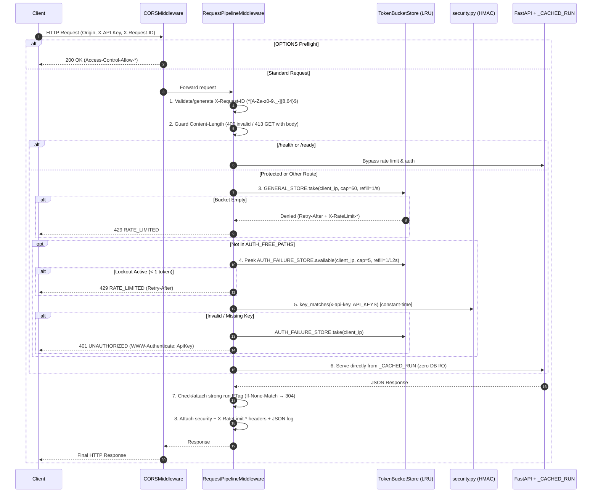

<div align="center">

<!-- Realistic Animated Aviation Hero Banner -->


<br/><br/>

<!-- Dynamic Typing Subtitle -->
<a href="https://github.com/kanglesoham11-code/airport-stand-allocation">
  
</a>

<br/>

<!-- Colorful Tech & Status Badges -->
<p>
  
  
  
  
  
  
  
  
</p>

<p>
  <a href="#-key-features"><b>Features</b></a> •
  <a href="#-system-design--architecture"><b>System Design</b></a> •
  <a href="#-optimization-model--timeline"><b>Optimization</b></a> •
  <a href="#-data-validation--kpis"><b>Validation &amp; KPIs</b></a> •
  <a href="#-tech-stack"><b>Tech Stack</b></a> •
  <a href="#-api-endpoints"><b>API Reference</b></a> •
  <a href="#-quick-start"><b>Quick Start</b></a>
</p>

</div>

---

## ✈️ About The Project

**Aleph Airport Stand Allocation** is a production-hardened aviation operations engine that assigns arriving and departing aircraft (`S`, `M`, `L`) to airport stands (`PLB` Passenger Loading Bridge contact gates and `REMOTE` apron stands) over a 6-hour planning window (`06:00–12:00 UTC`), enforcing safety turnaround buffers, stand-size compatibility, deterministic data cleaning, and explainable operational metrics.

Built from [`Aleph_Stand_Allocation_Build_Spec_v4.docx`](./Aleph_Stand_Allocation_Build_Spec_v4.docx), the service executes the complete ingestion, validation, dual-solver optimization, post-processing, metric computation, and atomic SQLite persistence pipeline **once at startup**, and serves every HTTP request from an **immutable in-memory `SavedRun` cache** with sub-20ms P95 latency.

<div align="center">
  
</div>

---

## 🌟 Key Features

<table>
  <tr>
    <td width="50%" valign="top">
      <h3>🧠 Dual-Candidate Optimization</h3>
      <ul>
        <li><b>Primary Exact Solver:</b> Google OR-Tools <b>CP-SAT</b> with boolean decision variables, <code>NewOptionalIntervalVar</code>, per-stand <code>AddNoOverlap</code>, and integer-scaled lexicographic objective weights:
          <br/><code>Maximize(Assigned → PLB Stands → -Oversize)</code></li>
        <li><b>Greedy Baseline:</b> Most-constrained-first heuristic ordered by <code>(compatible_count, arrival, flight_id)</code>.</li>
        <li><b>Fair Guardrail &amp; Invariant Check:</b> Shared 3-stage <code>post_process()</code> (fill → PLB upgrade → re-fill), automatic <code>FALLBACK_GREEDY</code> if greedy wins, and runtime <code>AllocationInvariantError</code> verification.</li>
      </ul>
    </td>
    <td width="50%" valign="top">
      <h3>🧹 16-Step Data Validation Engine</h3>
      <ul>
        <li>Deterministic row-by-row inspection of <code>flights.csv</code> with exact field ordering and full provenance.</li>
        <li><b>Auto-Repair (<code>FIXED</code>):</b> Normalizes lowercase sizes (<code>SIZE_FORMAT</code>) and converts timezone-offset timestamps to UTC (<code>OFFSET_TIMESTAMP</code>).</li>
        <li><b>Safe Rejection (<code>DROPPED</code>):</b> Enforces all 11 drop rules — bad field counts, empty/duplicate IDs, unknown sizes, missing/bad/naive/fractional timestamps, reversed times, invalid ground times (<code>&lt;20m</code> / <code>&gt;8h</code>), and out-of-window arrivals.</li>
      </ul>
    </td>
  </tr>
  <tr>
    <td width="50%" valign="top">
      <h3>🛡️ Security &amp; Dual Rate Limiting</h3>
      <ul>
        <li><b>Fail-Fast Startup Config:</b> Rejects missing keys, keys <code>&lt;32</code> chars, duplicates, and 10 placeholder strings (e.g., <code>changeme</code>) at import time.</li>
        <li><b>Constant-Time HMAC Auth:</b> <code>hmac.compare_digest</code> checks every configured key without short-circuiting so timing never leaks key position.</li>
        <li><b>Dual LRU Token Buckets:</b> Independent per-IP <code>GENERAL</code> (60 cap, 1/s refill) &amp; <code>AUTH_FAILURE</code> (5 cap, 1/12s refill) buckets bounded to <code>10,000</code> keys.</li>
      </ul>
    </td>
    <td width="50%" valign="top">
      <h3>📊 Explainability &amp; Observability</h3>
      <ul>
        <li><b>Blocker Explanations:</b> Unassigned flights report <code>NO_FREE_COMPATIBLE_STAND</code> or <code>NO_STAND_FOR_SIZE</code> with sorted blocking flight IDs (up to 6 shown + overflow count).</li>
        <li><b>8 Planning KPIs (<code>M1–M8</code>):</b> Assigned/unassigned counts, sweep-line peak demand, clipped stand utilisation (<code>Decimal ROUND_HALF_UP</code>), tight turns (<code>&lt;30m</code>), oversized placements, and solver gains over baseline.</li>
        <li><b>Telemetry &amp; Caching:</b> Single-line JSON access logs (8-hex SHA-256 key fingerprints only), <code>/ops/stats</code> nearest-rank P95 latency, and run-scoped <code>ETag</code> / <code>304</code> support.</li>
      </ul>
    </td>
  </tr>
</table>

---

## 📐 System Design & Architecture

<div align="center">
  
</div>

### End-to-End Request & Startup Pipeline

```mermaid
flowchart LR
    classDef input fill:#0f2347,stroke:#38bdf8,color:#e0f2fe,stroke-width:2px
    classDef process fill:#1e1b4b,stroke:#818cf8,color:#e0e7ff,stroke-width:2px
    classDef solver fill:#064e3b,stroke:#34d399,color:#d1fae5,stroke-width:2px
    classDef store fill:#31102f,stroke:#f472b6,color:#fce7f3,stroke-width:2px
    classDef api fill:#172554,stroke:#60a5fa,color:#dbeafe,stroke-width:2px

    A["📄 CSV Inputs<br/>stands.csv & flights.csv"]:::input --> B["🔍 loader.py<br/>BOM-safe, 5MB / 10k row caps"]:::process
    B --> C["🧹 validation.py & timeutil.py<br/>16-step FIXED/DROPPED audit"]:::process
    C --> D["⚡ solver_cpsat.py<br/>OR-Tools CP-SAT Exact"]:::solver
    C --> E["📐 allocator.py<br/>Most-Constrained Greedy"]:::solver
    D --> F["🔄 post_process()<br/>Fill → PLB Upgrade → Fill"]:::process
    E --> F
    F --> G["📊 metrics.py & SHA-256 Hashes<br/>M1–M8 + Blocker Reasons"]:::process
    G --> H["💾 repository.py & db.py<br/>BEGIN IMMEDIATE + Retention"]:::store
    H --> I["🧠 _CACHED_RUN<br/>Frozen In-Memory State"]:::solver
    I --> J["🚀 FastAPI + Middleware Stack<br/>CORS → Pipeline → Router"]:::api
```



### Runtime Request Pipeline (`CORSMiddleware` → `RequestPipelineMiddleware`)

Every incoming HTTP request passes through a strict deterministic pipeline before reaching route handlers:



### Deep-Dive System Components

| Component | Design Mechanism | Implementation Details |
|---|---|---|
| **Dual Rate Limiter** (`ratelimit.py`) | Thread-safe LRU-bounded Token Buckets | Two independent `TokenBucketStore` instances backed by `OrderedDict` (evicts LRU entry above `RATE_LIMIT_MAX_KEYS=10,000`) guarded by a per-store `Lock`. Uses monotonic clock injection (`now`), `RATE_EPSILON=1e-9` float tolerance, and `ceil_seconds()` for `Retry-After` & `X-RateLimit-Reset`.<br>• **General Bucket:** `60` capacity, `1.0` token/sec refill.<br>• **Auth-Failure Bucket:** `5` capacity, `1/12` token/sec refill (~12s penalty per burst). |
| **Client IP & Proxy Safety** (`middleware.py`) | Spoof-resistant IP extraction | Uses `request.client.host` by default; only reads the rightmost `X-Forwarded-For` IP when `TRUST_PROXY_HEADERS=True`. |
| **Constant-Time Auth & Fingerprinting** (`security.py`) | Timing-attack & secret-leak prevention | `key_matches()` iterates all configured keys with `hmac.compare_digest()` without early return. Logs record only `key_fingerprint()` (first 8 hex chars of SHA-256), never raw keys. |
| **Run-Scoped ETag Caching** (`security.py`, `middleware.py`) | Strong SHA-256 content-version tags | Cacheable `200` routes (`/allocations`, `/stands`, `/stands/{id}`, `/data-issues`, `/metrics`) emit `"<sha256(run_id\|path?query)[:32]>"` and short-circuit `304 Not Modified` on strong `If-None-Match` matches (ignoring weak `W/` tags). |
| **Immutable Domain & Zero-DB Reads** (`models.py`, `api.py`) | Frozen dataclasses + in-memory cache | `Flight`, `Stand`, `Allocation`, `DataIssue`, `Metric`, `Candidate`, `SolverOutcome`, and `SavedRun` are `@dataclass(frozen=True)`. Startup builds `_CACHED_RUN` once; requests never open SQLite connections. |
| **Atomic SQLite Persistence** (`db.py`, `repository.py`) | Single-transaction saves & retention | `db.py` creates short-lived connections with `isolation_level=None`, `PRAGMA foreign_keys = ON`, and `PRAGMA busy_timeout = 5000`. `save_run()` wraps `INCOMPLETE` insert → `stands` → `PRIMARY` & `BASELINE` `allocations` → `data_issues` → `metrics` → `COMPLETE` update → `apply_retention()` (purges incomplete runs + keeps latest `10` complete runs via `ON DELETE CASCADE`) inside `BEGIN IMMEDIATE ... COMMIT`. |
| **Schema Versioning** (`repository.py`) | Forward-compatibility protection | Tracks `schema_version` table (`SCHEMA_VERSION = 1`). Refuses newer DB schemas via `FutureSchemaError` instead of corrupting data. |
| **Structured JSON Logging** (`logging_setup.py`) | One JSON object per stdout line | Outputs `timestamp`, `level`, `logger`, `message`, `run_id`, `request_id`, route template, `status_class`, `duration_ms`, `rate_limited`, and `key_fingerprint`. Maps `401/429` → `WARNING`, `5xx` → `ERROR` with traceback, others → `INFO`. |
| **Operational Telemetry** (`ops.py`) | Bounded sliding-window P95 | `OpsCounters` maintains lock-protected `2xx/3xx/4xx/5xx` counts, `rate_limited_total`, `auth_failed_total`, `uptime_seconds`, and a `deque(maxlen=1000)` computing nearest-rank P95 latency (`ceil(0.95 * n)`). |
| **Uniform Error Envelope** (`api.py`, `middleware.py`) | Single JSON error contract | All `400`, `401`, `404` (including catch-all route), `405`, `413`, `422`, `429`, and `503` errors render as `{"error": {"code", "message", "request_id"}}`. |
| **Security Headers** (`middleware.py`) | Hardened defaults on every response | Sets `X-Frame-Options: DENY`, `X-Content-Type-Options: nosniff`, `Referrer-Policy: no-referrer`, `X-Request-ID`, plus `CORSMiddleware` for configured `ALLOWED_ORIGINS`. |
| **Defensive CSV & Config** (`loader.py`, `config.py`) | Bounded inputs & fail-fast settings | Caps CSV files at `5,000,000` bytes and `10,000` rows, strips UTF-8 BOM (`utf-8-sig`), validates exact headers, and exits with code `1` on invalid env config before serving traffic. |

---

## 📅 Optimization Model & Timeline

<div align="center">
  
</div>

### Mathematical Formulation (`solver_cpsat.py` & `allocator.py`)

- **Occupancy Interval:** Half-open $[t_{\text{arr}}(f),\; t_{\text{dep}}(f) + \text{buffer})$, so adjacent flights touching at `departure + 15m == next_arrival` do **not** conflict.
- **Decision Variables:** Boolean $x_{f,s} \in \{0, 1\}$ for every compatible pair where `SIZE_RANK[stand.max_size] >= SIZE_RANK[flight.aircraft_size]`, paired with `NewOptionalIntervalVar` on each stand.
- **Constraint C1 (At Most One Stand):** $\sum_{s \in \text{compat}(f)} x_{f,s} \le 1$ per flight (`AddAtMostOne`).
- **Constraint C2 (No Overlap + Turnaround Buffer):** `AddNoOverlap` across all optional intervals per stand.
- **Lexicographic Objective:** Integer-scaled weights guarantee strict hierarchy:
  1. **Maximize assigned flights** (`assign_weight = f_count * plb_weight + f_count * gap + 1`)
  2. **Maximize PLB contact stands** (`plb_weight = f_count * gap + 1`)
  3. **Minimize oversized placement waste** (`-(SIZE_RANK[stand.max_size] - SIZE_RANK[flight.aircraft_size])`)
- **Determinism:** Fixed `SOLVER_NUM_WORKERS=1` and `RANDOM_SEED=2027` ensure identical outputs across every startup.

---

## 🧹 Data Validation & KPIs

<details>
<summary><b>🔍 16-Step Validation Pipeline & All 13 Issue Codes (Click to expand)</b></summary>

`validation.py` processes `flights.csv` sequentially and sorts logged issues deterministically by `(row_number, field_order, issue_code)`:

| Action | Issue Code | Trigger Condition |
|---|---|---|
| `FIXED` | `SIZE_FORMAT` | Lowercase/mixed size normalized (`"m"` → `"M"`) |
| `FIXED` | `OFFSET_TIMESTAMP` | Non-`Z` timezone offset converted to UTC (`+05:30` → `Z`) |
| `DROPPED` | `WRONG_FIELD_COUNT` | CSV row does not have exactly 4 columns |
| `DROPPED` | `EMPTY_FLIGHT_ID` | `flight_id` is empty after stripping whitespace |
| `DROPPED` | `DUPLICATE_FLIGHT_ID` | `flight_id` already kept by an earlier valid row |
| `DROPPED` | `UNKNOWN_SIZE` | `aircraft_size` not in `{S, M, L}` |
| `DROPPED` | `MISSING_VALUE` | Empty `arrival_time` or `departure_time` |
| `DROPPED` | `BAD_TIMESTAMP` | Malformed ISO-8601 timestamp string |
| `DROPPED` | `NAIVE_TIMESTAMP` | Timestamp lacks timezone offset or `Z` |
| `DROPPED` | `FRACTIONAL_TIMESTAMP` | Timestamp contains fractional seconds |
| `DROPPED` | `DEPARTURE_BEFORE_ARRIVAL` | `departure <= arrival` |
| `DROPPED` | `GROUND_TOO_SHORT` | Ground duration `< 20 minutes` |
| `DROPPED` | `GROUND_TOO_LONG` | Ground duration `> 8 hours` |
| `DROPPED` | `ARRIVAL_OUTSIDE_WINDOW` | Arrival outside `[2027-01-15T06:00:00Z, 2027-01-15T12:00:00Z)` |

</details>

<details>
<summary><b>📈 All 8 Operational Metrics (M1–M8) from Default Run (Click to expand)</b></summary>

| ID | Metric | Observed Value | Definition & Calculation |
|---|---|---|---|
| **M1** | Assigned flights | `30` flights | Valid flights assigned to a stand (`71.4%` of 42 valid) |
| **M2** | Unassigned flights | `12` flights | Valid flights left unplaced with blocker reason codes |
| **M3** | Peak demand | `12` stands | Sweep-line max concurrent stands incl. 15m buffer (first at `09:15 UTC`) |
| **M4** | Stand utilisation | `40.3%` | Clipped occupied stand-seconds (`104,400 / 259,200`) via `Decimal ROUND_HALF_UP` |
| **M5** | Tight turns | `13` turns | Consecutive flights on the same stand with gap `< 30 minutes` |
| **M6** | Oversized placements | `8` placements | Assigned flights placed on a stand larger than aircraft size |
| **M7** | PLB flights gained | `+2` flights | Primary PLB count minus greedy baseline PLB count |
| **M8** | Assigned flights gained | `+4` flights | Primary assigned count minus greedy baseline assigned count |

</details>

---

## 🔧 Tech Stack

<div align="center">

| Category | Technologies | Role in Project |
|---|---|---|
| **Web Framework** |    | ASGI HTTP server, OpenAPI `/docs`, `CORSMiddleware`, `BaseHTTPMiddleware` |
| **Optimization** |  | Exact CP-SAT interval scheduling & lexicographic optimization |
| **Validation & Types** |   | `Literal`-constrained OpenAPI schemas, `Decimal` precision, frozen dataclasses |
| **Persistence** |  | Versioned schema migrations, `BEGIN IMMEDIATE` transactions, retention pruning |
| **Quality & Testing** |     | 44 unit & integration tests (incl. brute-force solver verification), linting, static typing |
| **Containerization** |  | Multi-layer `python:3.10-slim` container with built-in `/health` probe |

</div>

---

## 📡 API Endpoints

> All data endpoints require the `X-API-Key` header. Every response includes `X-Request-ID`, security headers, and `X-RateLimit-*` headers. Cacheable GET routes emit run-scoped `ETag` headers supporting `If-None-Match` → `304 Not Modified`.

| Method & Path | Auth | Description |
|---|---|---|
| `GET /health` | No | Liveness probe (`{"status": "ok"}`) |
| `GET /ready` | No | Readiness probe with active `run_id`, stand/flight/issue counts, and `solver_status` |
| `GET /docs` | No | Interactive Swagger UI backed by `Literal`-typed OpenAPI schemas |
| `GET /allocations` | **Yes** | Paginated flight allocations (`?status=ASSIGNED\|UNASSIGNED&limit=100&offset=0`) |
| `GET /stands` | **Yes** | List of all 12 airport stands (`PLB` / `REMOTE`, `S` / `M` / `L`) |
| `GET /stands/{stand_id}` | **Yes** | Stand details and assigned flights timeline (validated `[A-Z0-9]{1,8}`, e.g., `/stands/C01`) |
| `GET /data-issues` | **Yes** | Paginated validation audit log (`FIXED` and `DROPPED` rows) |
| `GET /metrics` | **Yes** | Full `M1–M8` operational & baseline-comparison KPIs |
| `GET /ops/stats` | **Yes** | Uptime, `2xx/3xx/4xx/5xx` counts, rate-limit/auth-failure counters, P95 latency |

<details>
<summary><b>📦 Sample API Responses (Click to expand)</b></summary>

**`GET /ready`**
```json
{
  "status": "ready",
  "run_id": "run-0002",
  "stands": 12,
  "valid_flights": 42,
  "data_issues": 9,
  "loaded_at": "2026-11-25T12:34:29.541Z",
  "allocator": "cpsat",
  "primary_method": "cpsat",
  "solver_status": "FEASIBLE"
}
```

**`GET /allocations?status=UNASSIGNED&limit=1`**
```json
{
  "planning_window": { "start": "2027-01-15T06:00:00Z", "end": "2027-01-15T12:00:00Z" },
  "run_id": "run-0002",
  "allocator": "cpsat",
  "primary_method": "cpsat",
  "solver_status": "FEASIBLE",
  "total": 12,
  "limit": 1,
  "offset": 0,
  "allocations": [
    {
      "flight_id": "FR207",
      "aircraft_size": "M",
      "arrival_time": "2027-01-15T07:15:00Z",
      "departure_time": "2027-01-15T08:40:00Z",
      "status": "UNASSIGNED",
      "stand_id": null,
      "stand_type": null,
      "note": null,
      "reason_code": "NO_FREE_COMPATIBLE_STAND",
      "reason": "All 7 stands that can take size M aircraft are busy between 07:15 UTC and 08:40 UTC UTC, including the 15-minute buffer. Blocked by: AX686, BQ274, BQ322, BQ901, CZ554, CZ728 and 7 more."
    }
  ]
}
```

**`GET /ops/stats`**
```json
{
  "uptime_seconds": 20.797,
  "run_id": "run-0002",
  "requests_total": { "2xx": 7, "3xx": 0, "4xx": 0, "5xx": 0 },
  "rate_limited_total": 0,
  "auth_failed_total": 1,
  "latency_p95_ms": 16.0
}
```

</details>

---

## 📁 Project Structure

```text
stand-allocation/
├── stand_allocation/
│   ├── api.py              # FastAPI app, endpoints, in-memory _CACHED_RUN, CORSMiddleware
│   ├── middleware.py       # Request ID, Content-Length check, dual rate limit, HMAC auth, ETag, logs
│   ├── config.py           # Environment config & fail-fast startup validation
│   ├── models.py           # Frozen dataclasses (Flight, Stand, Allocation, Metric, SavedRun)
│   ├── schemas.py          # Pydantic v2 response models with Literal enum constraints
│   ├── service.py          # Startup pipeline orchestrator (load → validate → solve → save)
│   ├── solver_cpsat.py     # Google OR-Tools CP-SAT interval scheduling solver
│   ├── allocator.py        # Greedy baseline, post_process(), fit/conflict/reason & invariant checks
│   ├── validation.py       # 16-step CSV row validator (FIXED & DROPPED semantics)
│   ├── loader.py           # BOM-aware CSV reader with file-size and row-count guards
│   ├── metrics.py          # M1–M8 calculations (sweep-line peak demand, Decimal utilisation)
│   ├── repository.py       # SQLite schema migrations, transactional save_run, retention pruning
│   ├── db.py               # Short-lived SQLite connection factory with foreign keys & busy timeout
│   ├── ratelimit.py        # Thread-safe LRU-bounded token bucket stores (GENERAL & AUTH_FAILURE)
│   ├── security.py         # Constant-time HMAC key matching, SHA-256 fingerprints, ETags
│   ├── ops.py              # Thread-safe request counters & nearest-rank P95 latency
│   ├── logging_setup.py    # JSON-line structured stdout logger
│   ├── timeutil.py         # Strict UTC timestamp parser & formatter
│   └── generate_data.py    # Deterministic dataset generator (seed=2027)
├── tests/                  # 44 unit & API tests + golden CSV snapshot
├── docs/assets/            # Realistic animated SVGs for README
├── data/                   # Generated stands.csv & flights.csv
├── Dockerfile              # Production container image with /health check
├── .dockerignore           # Excludes caches, local DB, tests, and dev tooling from image
├── Makefile                # install, data, run, test, check targets
└── Aleph_Stand_Allocation_Build_Spec_v4.docx
```

---

## 🚀 Quick Start

### 1. Install Dependencies

```bash
pip install -r requirements.txt -r requirements-dev.txt
```

### 2. Generate Deterministic Dataset *(optional — already included in `data/`)*

```bash
python -m stand_allocation.generate_data
```

### 3. Configure Environment & Start Server

`API_KEYS` must be at least **32 characters** and cannot use placeholder values like `changeme`.

**Linux / macOS:**
```bash
export API_KEYS="aleph-prod-key-change-me-at-least-32-characters"
export ALLOCATOR=cpsat
export BUFFER_MINUTES=15
python -m uvicorn stand_allocation.api:app --host 127.0.0.1 --port 8000 --timeout-keep-alive 5 --limit-concurrency 100
```

**Windows (PowerShell):**
```powershell
$env:API_KEYS="aleph-prod-key-change-me-at-least-32-characters"
$env:ALLOCATOR="cpsat"
$env:BUFFER_MINUTES="15"
python -m uvicorn stand_allocation.api:app --host 127.0.0.1 --port 8000 --timeout-keep-alive 5 --limit-concurrency 100
```

### 4. Query the API

```bash
curl -s http://127.0.0.1:8000/ready
curl -s -H "X-API-Key: aleph-prod-key-change-me-at-least-32-characters" http://127.0.0.1:8000/metrics
```

### 5. Run with Docker

```bash
docker build -t aleph-stand-allocation .
docker run -p 8000:8000 \
  -e API_KEYS="aleph-prod-key-change-me-at-least-32-characters" \
  -e ALLOWED_ORIGINS="https://your-dashboard.example.com" \
  aleph-stand-allocation
```

---

## 🧪 Testing & Quality Checks

```bash
# Run all 44 tests
python -m pytest -v

# Lint with Ruff
python -m ruff check .

# Type-check with Mypy
python -m mypy stand_allocation
```

| Test Module | What It Verifies |
|---|---|
| `test_cpsat.py` | CP-SAT matches exhaustive brute-force solver, determinism, never worse than greedy, long-stay blocking |
| `test_allocator.py` | Buffer seconds, fill pass, PLB upgrade pass, `AllocationInvariantError` invariant check |
| `test_validation.py` | Reversed timestamps, offset conversion, size normalization, duplicates, bad field counts, ground limits, BOM |
| `test_api.py` | Auth enforcement, 400/404/422 error envelopes, cached zero-DB reads, OpenAPI `Literal` enum schemas |
| `test_ratelimit.py` | Injected deterministic clock, token refill math, auth-failure lockout & recovery |
| `test_security.py` | Constant-time key matching, 8-hex key fingerprints, ETag generation/matching, request ID regex |
| `test_metrics.py` | `Decimal ROUND_HALF_UP` rounding and `M7`/`M8` baseline comparisons |
| `test_migrations.py` & `test_repository.py` | Schema migration to v1 and `run-0001` ID formatting |
| `test_ops.py`, `test_config.py`, `test_timeutil.py`, `test_generator.py` | Nearest-rank P95, config guardrails + `ALLOWED_ORIGINS`, UTC parsing, golden CSV head match |

---

## ⚙️ Environment Variables

| Variable | Default | Description |
|---|---|---|
| `API_KEYS` | *(required)* | Comma-separated API keys (each `>= 32` chars, unique, non-placeholder) |
| `ALLOCATOR` | `cpsat` | Allocation strategy: `cpsat` (with greedy fallback) or `greedy` |
| `BUFFER_MINUTES` | `15` | Turnaround safety buffer after departure (`0..60`) |
| `SOLVER_TIME_LIMIT_SECONDS` | `10` | CP-SAT solver max runtime (`>0` and `<=60`) |
| `ALLOWED_ORIGINS` | `""` | Comma-separated CORS origins enabled via `CORSMiddleware` |
| `LOG_LEVEL` | `INFO` | `DEBUG`, `INFO`, `WARNING`, or `ERROR` |
| `DB_PATH` | `data/allocation.db` | SQLite database file path |

---

<div align="center">


**Built with precision for Airport Operations • [OpenAPI Docs](http://127.0.0.1:8000/docs)**

</div>
